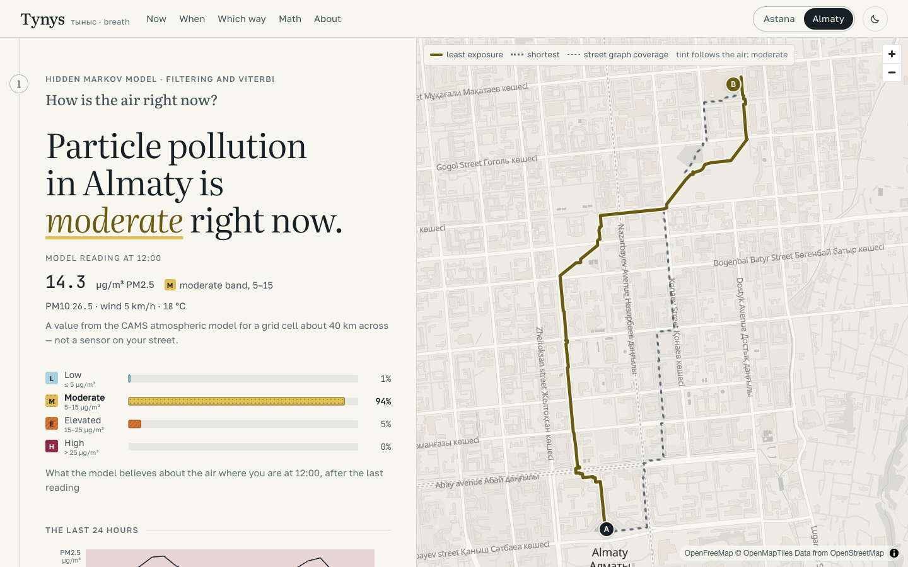
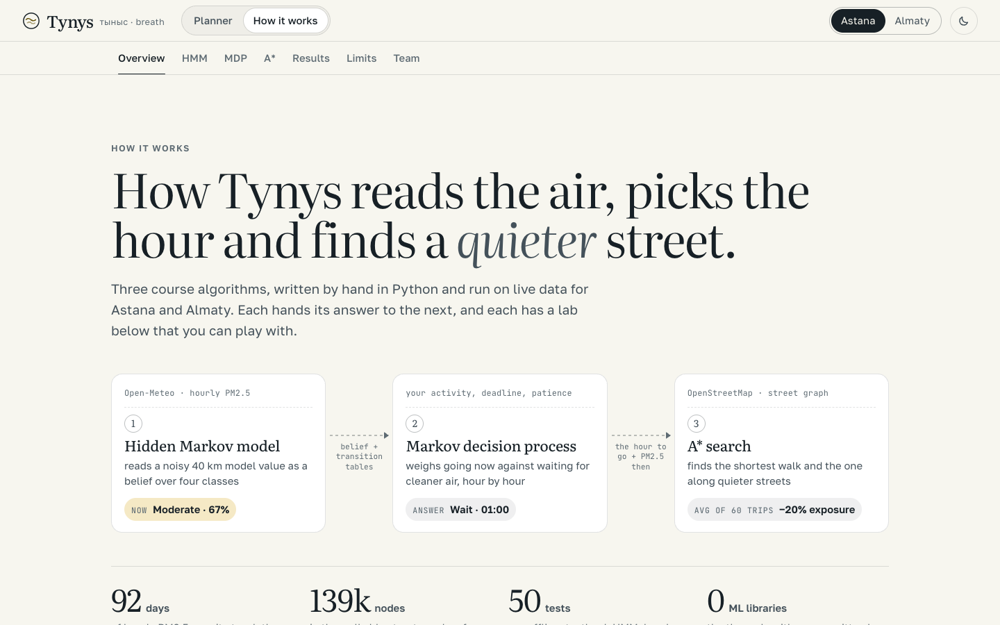
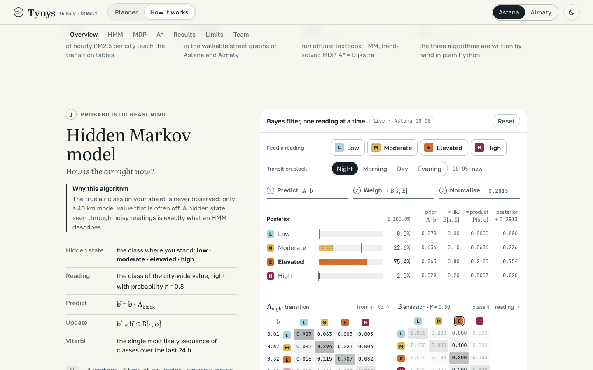
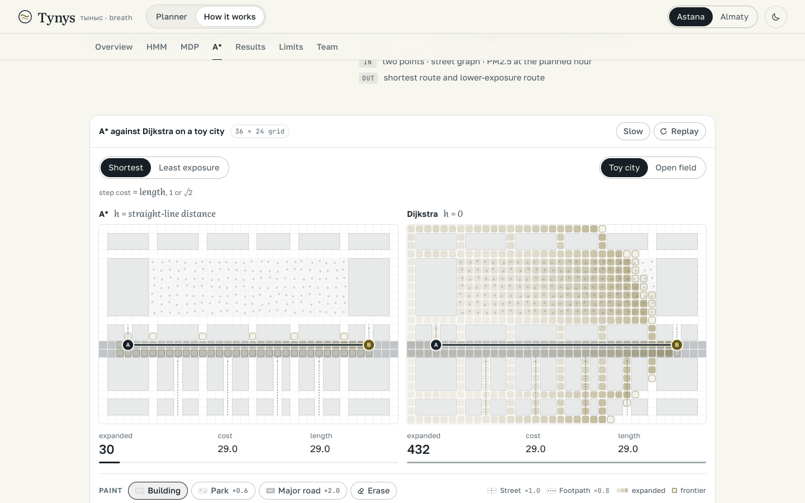
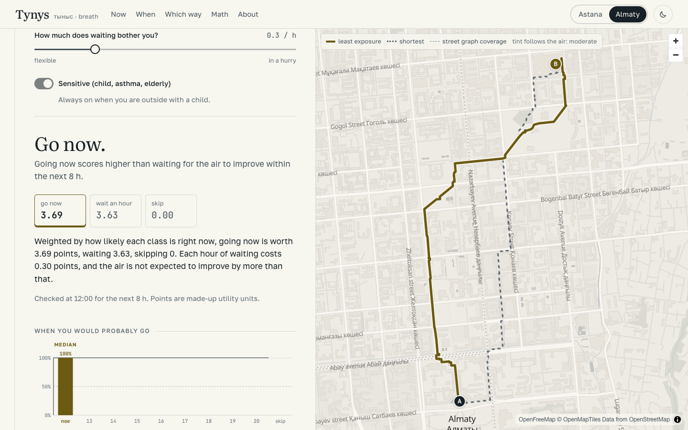
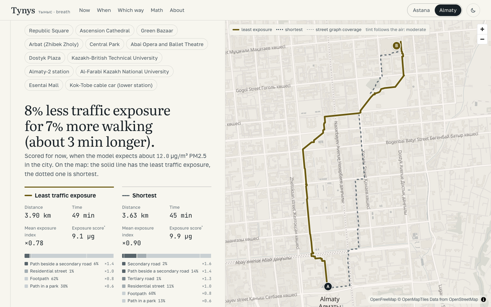
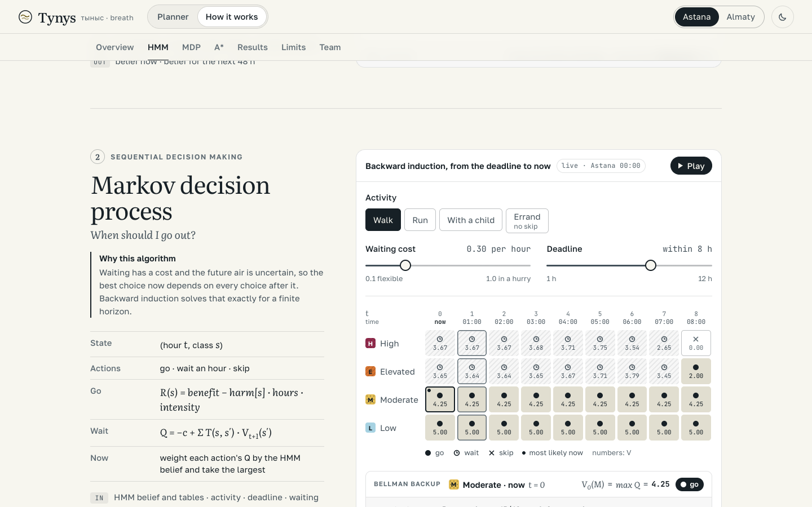
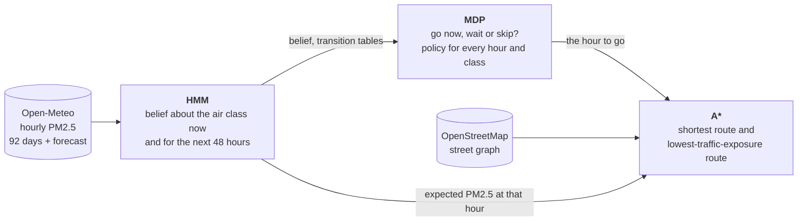

# Tynys

**An air-quality planner for Astana and Almaty.** *Tynys* (тыныс) is Kazakh for "breath".

It answers three questions you have on a smoggy day, each with a different AI algorithm, on live data:

| Question | Algorithm | Course topic |
|---|---|---|
| How is the air right now? | Hidden Markov model: Bayes filtering and Viterbi | Probabilistic reasoning |
| When should I go out? | Markov decision process solved by backward induction | Sequential decision making |
| Which way should I walk? | A* on the real street network with an exposure-weighted cost | Search |

Final project for **AIF1303 AI Fundamentals**, QAIRU, trimester 1, 2026–27.
Team: **Tair Kaldybayev** ([@tairqaldy](https://github.com/tairqaldy)) and **Dameli Kalikhanova** ([@dameo111](https://github.com/dameo111)).

**Live: <https://tynys-blond.vercel.app>** · **[How it works](https://tynys-blond.vercel.app/docs)** (interactive labs for the three algorithms) · [defense notes](docs/DEFENSE.md) · [evaluation](docs/evaluation.md) · [specification](docs/SPEC.md)



| How it works: the pipeline | Bayes filter lab | A* against Dijkstra lab |
|---|---|---|
|  |  |  |

| When should I go out? | Which way should I walk? | Backward induction lab |
|---|---|---|
|  |  |  |

## How the three parts work together



They are not three separate demos. The HMM's belief is the MDP's starting point, and the MDP's
dynamics are built from the HMM's transition and emission tables. The hour the MDP recommends selects
the pollution level used to score the two routes A* finds.

## Run it

Python 3.12, standard library only. No packages to install for the algorithms, the tests or the API.

```bash
python -m tynys.demo --city almaty
```

prints, for each algorithm, **input → steps → output → why this algorithm**. Add `--offline` to use the
bundled data snapshot instead of the live API. Real runs are saved in
[`docs/demo_output_almaty.txt`](docs/demo_output_almaty.txt) and [`docs/demo_output_astana.txt`](docs/demo_output_astana.txt).

```bash
python -m unittest discover tests
```

runs 50 tests offline: the umbrella-world HMM from the textbook, a hand-solved MDP, A* on a grid with a
wall, A* against Dijkstra on the real street graphs, and checks that every hour index in the API lines up.
The web interface has its own tests (`pnpm test`): the API contract, every section rendered with each saved
response, the labs' TypeScript versions of the Bayes step and the Bellman backup checked against the Python
results, and the lab's grid A* checked against Dijkstra.

```bash
python -m tynys.evaluate
```

regenerates [`docs/evaluation.md`](docs/evaluation.md).

The web app needs Node 22 and pnpm. In one terminal start the API, in another the interface, then open
<http://localhost:5173> (the planner) and <http://localhost:5173/docs> (how it works):

```bash
python -m tynys.devserver
```

```bash
pnpm install && pnpm dev
```

## Sample output

From a real run for Almaty on 10 November 2026, 12:00 local time (shortened; the full text is in `docs/`).

**1. HMM.** The model reading was 14.3 µg/m³, two hours after a morning in the "high" band. One Bayes update:

```
predicted prior  Aᵀ·belief(t−1) = [0.0171 0.6592 0.2996 0.0242]      low / moderate / elevated / high
likelihood       B[:, reading]  = [0.2000 0.8000 0.1000 0.0000]      the reading's band was "moderate"
unnormalised     product        = [0.0034 0.5274 0.0300 0.0000]
evidence         sum            = 0.5607
posterior        product / sum  = [0.0061 0.9405 0.0534 0.0000]      → most likely class: moderate
```

**2. MDP.** A 45-minute walk within 8 hours, waiting costs 0.3 points per hour:

```
R_go(s) = benefit − harm[s]·hours·intensity = [5.00 4.25 2.00 −2.50]
Bellman, class "moderate" at t = 0:
  Q_wait = −0.3 + [0.005 0.970 0.025 0.000] · [5.00 4.25 3.09 3.65] = 3.92      Q_go = 4.25
Belief-weighted: Q(go) = 4.13, Q(wait) = 3.89, Q(skip) = 0
Decision: GO NOW
```

An hour earlier the same walk got the opposite answer. The belief was then 67% moderate and 32%
elevated, which gave Q(go) = 3.54 against Q(wait) = 3.83: for the most likely class going was already
better, but the one-in-three chance of "elevated" air, where waiting is clearly worth it, tipped the
decision to "wait". One more moderate reading moved the belief to 94% and the decision to "go".

**3. A\*.** Republic Square to the Green Bazaar:

```
search          A* expanded  Dijkstra expanded  saved  same cost
shortest        6,007        34,680             83%    yes
lower-exposure  9,530        30,269             69%    yes

route           metres  minutes  mean index  main kinds
shortest        3,633   45.4     0.90        path 60%, beside a secondary road 14%, park 13%
lower-exposure  3,898   48.7     0.78        path 62%, park 30%, beside a secondary road 6%
→ 7.6% less traffic exposure for 7.3% more walking
```

## The model in one page

The full specification, with every formula, is in [`docs/SPEC.md`](docs/SPEC.md).

- **Classes.** Hourly PM2.5 is put into four bands: low (≤ 5 µg/m³), moderate (5–15), elevated (15–25),
  high (> 25). The true class where you stand is the hidden state; the band of the city-wide model value
  is the reading.
- **HMM.** Four transition matrices (night, morning, day, evening) are counted from 92 days of hourly
  readings with add-one smoothing; rows with fewer than 20 counts fall back to the all-day matrix. The
  emission matrix puts the trust `r` (default 0.8) on the diagonal and the rest on the neighbouring
  bands. The forward filter runs over the last 24 hours; Viterbi decodes the most likely sequence;
  the forecast is used as a weaker reading for the next 48 hours.
- **MDP.** State = (hour, class). Actions = go, wait, skip. Going earns `benefit − harm[class] × hours ×
  intensity × sensitivity`; waiting costs a fixed amount per hour; skipping earns 0. While waiting, the
  class moves according to `P(next class | class now, next forecast)`, built from the HMM tables with
  Bayes' rule. Backward induction gives the best action for every hour and class. The action now is
  weighted by the HMM belief.
- **A\*.** The graph is every walkable OpenStreetMap way in the city centre (Astana 75,986 nodes, Almaty
  63,379). The "shortest" search costs an edge by its length; the "lower-exposure" search multiplies length by
  a traffic exposure index (2.0 along a major road down to 0.6 inside a park). The heuristic is the
  straight-line distance times the smallest index, so it never overestimates and A* stays optimal.

## Does it work?

From [`docs/evaluation.md`](docs/evaluation.md), computed on the last 14 days of history:

- **A\*** expands about 82% fewer nodes than Dijkstra for the shortest route and about 61% fewer for the
  exposure-weighted one, with identical costs on every tested pair. The lower-exposure route cuts the
  weighted cost by about 20% for 6–9% more distance, averaged over 30 trips per city.
- **MDP.** Replaying every hour of the test period as "now", for a walk in Almaty: "always go now"
  earns −0.02 points on average, the policy 1.25 when it is given no information about the future
  (the forecast is just "same as now") and 1.80 with a perfect forecast; an oracle that knows the future
  gets 1.85. The real app sits between 1.25 and 1.80, because it has a real forecast with errors. In
  Astana, where the air is usually fine, there is less to gain (3.37, 3.57, 3.82, oracle 3.86), and for
  an errand that cannot be skipped the no-information policy does not beat "go now" (4.905 against 4.912).
- **HMM, a negative result.** One hour ahead, the transition matrices alone predict exactly what
  "the class stays the same" predicts. Six hours ahead they beat that baseline in Astana (62% against 55%)
  and lose badly in Almaty (19% against 37%), because the heating season began inside the test period.
  The app does not rely on the matrices alone: its prediction also uses the forecast.

## Assumptions and limits

- **The PM2.5 values are model output, not measurements.** Open-Meteo serves the CAMS global
  atmospheric model, about 40 km per grid cell, and its past hours are earlier model runs. It smooths
  street-level peaks. Tynys is about timing and relative exposure, not absolute health claims, and it
  is not medical advice.
- The class cut-points come from WHO 2021 annual and 24-hour guidance and are applied to hourly values;
  WHO defines no hourly PM2.5 guideline.
- The reading trust `r` and the forecast trust are settings, not estimated from data.
- The benefit, harm and waiting numbers are utility points chosen by hand.
- The action rule (QMDP) assumes the uncertainty about the class disappears after one step.
- The traffic exposure index is a proxy for pollution next to busy roads (NO₂, soot), built from
  OpenStreetMap road classes and a 25 m roadside rule. It is not measured, and PM2.5 itself differs
  much less between streets. The exposure score only compares two routes.
- Routes cover the central part of each city (the dashed outline on the map).

What would improve it is listed at the end of the evaluation: street-level sensors to calibrate the
reading trust, an archive of real forecasts for an honest backtest, a richer state, and a proper POMDP.

## Layout

```
tynys/      hmm.py  mdp.py  astar.py      the three algorithms, hand-written, no libraries
            classes.py data.py graph.py service.py evaluate.py demo.py devserver.py web.py
api/        one thin Vercel Python function per endpoint: meta, air, plan, route, places
scripts/    build the street graphs (Overpass), the place list (Photon), the air snapshot
data/       street graphs, places, air snapshot
tests/      unittest, offline
src/        web interface: Vite, React, TypeScript, MapLibre; charts are hand-built SVG
src/docs/   the /docs page: the pipeline, the three interactive labs, evaluation charts, team
docs/       SPEC.md, evaluation.md, demo outputs, DEFENSE.md, AI-USAGE.md
```

## Data and credits

- Air quality and weather: [Open-Meteo](https://open-meteo.com/) (CC BY 4.0), from the Copernicus
  Atmosphere Monitoring Service (CAMS) global model.
- Streets and parks: © [OpenStreetMap](https://www.openstreetmap.org/copyright) contributors, under the
  Open Database License, fetched through the Overpass API. The files in `data/graph_*.json` are derived
  from it and carry the same license.
- Place search: [Photon](https://photon.komoot.io/) by Komoot. Map tiles: [OpenFreeMap](https://openfreemap.org/).
- Fonts: Literata, Golos Text, JetBrains Mono (SIL Open Font License).

## Team

Tair Kaldybayev and Dameli Kalikhanova, AI & ML, year 1. The work was done together on one laptop, so
all commits come from one account.

## AI assistance

This project was built with substantial help from Claude (Anthropic). What the AI did and how the
result was checked is recorded in [`docs/AI-USAGE.md`](docs/AI-USAGE.md).
